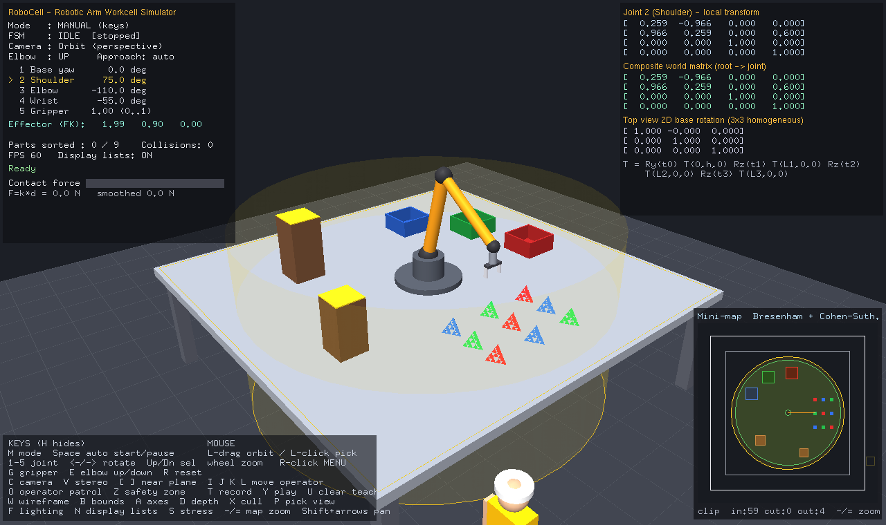

# RoboCell: Interactive Robotic Arm Workcell Simulator

**CS373IA Computer Graphics and Virtual Reality mini project (team of 2)**

RoboCell is a 5-DOF industrial robot arm in a workcell, written in C++17 with classic OpenGL and freeGLUT. The arm picks coloured Sierpinski-pyramid parts off a table and sorts them into matching bins. It solves inverse kinematics when you click a target and refuses any move that would collide. It also freezes when a human operator walks into its safety zone.

Pitch: *an operator-training and safety simulator for industrial robot workcells.*



---

## 1. Building and running

### Windows: Visual Studio 2022 + vcpkg (recommended)

1. Install **Visual Studio 2022** with the "Desktop development with C++" workload, which includes CMake.
2. Install vcpkg once and freeGLUT:
   ```bat
   git clone https://github.com/microsoft/vcpkg C:\vcpkg
   C:\vcpkg\bootstrap-vcpkg.bat
   C:\vcpkg\vcpkg install freeglut:x64-windows
   C:\vcpkg\vcpkg integrate install
   ```
3. Build, or run `build_vs.bat`:
   ```bat
   cd D:\CGVR_project\RoboCell
   cmake -B build -S . -DCMAKE_TOOLCHAIN_FILE=C:/vcpkg/scripts/buildsystems/vcpkg.cmake
   cmake --build build --config Release
   build\Release\RoboCell.exe
   ```
   vcpkg copies `freeglut.dll` next to the exe automatically.
   You can also open the folder in Visual Studio (File → Open → Folder) and press F5.

### Windows: MSYS2 / MinGW (lighter alternative)

1. Install MSYS2, open the **UCRT64** shell and run:
   `pacman -S mingw-w64-ucrt-x86_64-gcc mingw-w64-ucrt-x86_64-freeglut`
2. Run `build_mingw.bat`, which uses one g++ command, or use CMake with `-G "MinGW Makefiles"`.
3. Run `RoboCell.exe`. If `libfreeglut.dll` is not found, add `C:\msys64\ucrt64\bin` to PATH.

### Linux

```bash
sudo apt install build-essential cmake freeglut3-dev
cmake -B build -S . && cmake --build build -j
./build/RoboCell
./build/RoboCellTests        # algorithm self-tests
```

---

## 2. Controls

| Key / mouse | Action |
| --- | --- |
| **Right-click** | Pop-up menu with mode, camera, display toggles, clipping/line algorithm, Sierpinski depth, safety, teach mode, reset |
| **Left-drag** | Orbit the camera (pan in the top view) |
| **Left-click** | Colour-pick a part or a table point. In IK mode the arm goes there |
| Wheel / PgUp / PgDn | Zoom |
| **M** | Cycle mode: Manual → IK → Auto |
| **Space** | Start / pause the autonomous pick-and-place |
| 1–5, ↑ ↓ | Select joint (base, shoulder, elbow, wrist, gripper) |
| ← → | Rotate the selected joint (Manual) |
| **G** | Open/close gripper. Closing near a part grabs it; opening drops it (into a bin if above one) |
| **E** | IK elbow-up / elbow-down solution |
| **C** | Camera: Orbit (perspective) → Top (orthographic) → Gripper cam |
| **V** | Side-by-side stereo "VR" view |
| [ ] | Move the near clipping plane (3D clipping demo) |
| I J K L | Move the operator. **O** toggles the operator's patrol behaviour |
| **Z** | Safety zone on/off |
| T / Y / U | Teach mode: record waypoint / play back / clear |
| W B A | Wireframe / bounding volumes / joint axes |
| D X | Depth buffer (z-buffer) on/off / back-face culling on/off |
| P | Show the colour-ID pick buffer |
| F N S | Lighting / display lists on/off / stress test (225 extra pyramids) |
| - = , Shift+arrows | Zoom / pan the mini-map world window |
| R | Reset the cell |
| H | Hide help · **Q / Esc** quit |

---

## 3. Features mapped to the syllabus

| Unit | Topic | Where it is in RoboCell | Source file |
| --- | --- | --- | --- |
| I | OpenGL primitives and attributes | Everything is built from GL_QUADS, GL_QUAD_STRIP, GL_TRIANGLE_FAN, GL_TRIANGLES, GL_LINES (W shows the wireframe) | `scene/Primitives.cpp` |
| I | RGB vs indexed colour | Parts and bins store a **palette index**; the pick pass writes raw IDs | `scene/Scene.cpp` (`PALETTE`) |
| I | Display lists | Floor, table, base, links, bin, part and operator are compiled with `glNewList`. **N** switches to immediate mode; compare FPS with **S** | `Scene::init / callList` |
| I | 3D Sierpinski gasket | Every part is a recursive gasket; menu sets depth 0–4 | `scene/Sierpinski.cpp` |
| I | VR: 3 I's, 5 components | Immersion (gripper cam, stereo pair), interaction (picking, teleoperation), imagination (what-if layouts) | report |
| II | Event-driven input, keyboard, mouse, window events | GLUT callbacks; `glutReshapeFunc` keeps the aspect ratio | `input/Input.cpp` |
| II | Menus | Right-click menu with 8 sub-menus and live `[x]` toggle labels | `Input::createMenus` |
| II | Logical devices, measure and trigger | Locator (mouse position = measure, click = trigger); pick device by colour ID + `glReadPixels` + `gluUnProject` | `view/Renderer.cpp` (`pickAt`) |
| II | VR output: sound and haptics | Collision/safety beep (sound display); contact-force bar (haptic stand-in) | `main.cpp`, `physics/Force.cpp` |
| III | DDA, Bresenham | Mini-map path and arm lines; switch algorithm from the menu | `raster/Raster2D.cpp` |
| III | Midpoint circle | Reach rings \|L1−L2\| and L1+L2 on the mini-map | `raster/Raster2D.cpp` |
| III | Scan-line, boundary and flood fill | Safety zone (scan-line, blended), obstacles and bins (boundary fill), reachable annulus (flood fill) | `raster/Raster2D.cpp`, `ui/Hud.cpp` |
| III | Window-to-viewport | World window (x, z) → mini-map viewport; zoom and pan it | `raster/Clip2D.cpp` |
| III | Cohen-Sutherland, Liang-Barsky | All mini-map lines are clipped to the inner window. The dim grey lines show what was clipped away; the counter shows in/cut/out | `raster/Clip2D.cpp` |
| III | Sutherland-Hodgman | Safety-zone polygon clipped to the window before filling | `raster/Clip2D.cpp` |
| III | 2D transforms, homogeneous coordinates | HUD shows the 3×3 homogeneous base rotation (top view) | `ui/Hud.cpp` |
| IV | 3D transforms, composite matrices | HUD prints the selected joint's local 4×4 and composite world 4×4 | `math/Mat4.h`, `ui/Hud.cpp` |
| IV | Viewing pipeline, projections | Orbit (`gluPerspective` + `gluLookAt`), Top (`glOrtho`), Gripper cam (from the FK matrix) | `view/Camera.cpp` |
| IV | 3D clipping, view volume | [ / ] move the near plane | `view/Camera.cpp` |
| IV | Back-face detection, depth buffer | **X** / **D** toggles show what goes wrong without them | `view/Renderer.cpp` |
| IV | Depth sorting (painter's) | The translucent safety cylinder's faces are sorted back-to-front every frame | `Scene::drawSafetyZone` |
| V | Geometric modelling: shape, appearance | Links from primitives, materials, two lights | `scene/`, `view/Renderer.cpp` |
| V | Kinematics: homogeneous matrices, hierarchy | `glPushMatrix`/`glPopMatrix` chain base→shoulder→elbow→wrist→gripper; FK with our `Mat4` | `arm/Arm.cpp` |
| V | Inverse kinematics (object position) | Closed form: base yaw + law of cosines + wrist compensation, elbow up/down, reach check | `arm/IK.cpp` |
| V | Collision detection | Link capsules vs AABBs (exact segment–box distance); table check; red links; motion blocked | `physics/Collision.cpp`, `Simulation.cpp` |
| V | Force computation, smoothing, mapping | F = k·d at the fingertip, exponential smoothing, mapped to bar colour | `physics/Force.cpp` |
| V | Behaviour modelling | Pick-and-place FSM (IDLE→APPROACH→DESCEND→GRASP→LIFT→TRANSFER→RELEASE→RETRACT, plus HALT and RECOVER); operator patrol | `arm/Behaviour.cpp` |
| Stretch | Stereo VR, teach mode, stress benchmark | **V**, **T/Y/U**, **S** | various |

---

## 4. Key maths (for the viva)

**Forward kinematics** (`computeFK`):

T = Ry(θ0) · T(0,h,0) · Rz(θ1) · T(L1,0,0) · Rz(θ2) · T(L2,0,0) · Rz(θ3) · T(L3,0,0)

The tip position is the last column. Link lengths are h = 0.6, L1 = 2.0, L2 = 1.8 and L3 = 0.6.

**Inverse kinematics** (`solveIK`), with the target (x, y, z) and the gripper approach pitch φ (−90° = down):

- θ0 = atan2(−z, x). `glRotatef` about +Y turns +X toward −Z.
- r = √(x²+z²) − L3·cos φ and y′ = y − h − L3·sin φ.
- Reachable only if |L1−L2| ≤ √(r²+y′²) ≤ L1+L2.
- cos θ2 = (r² + y′² − L1² − L2²) / (2·L1·L2), clamped to [−1, 1]. Elbow-up uses the negative root.
- θ1 = atan2(y′, r) − atan2(L2·sin θ2, L1 + L2·cos θ2).
- θ3 = φ − θ1 − θ2.

**Smooth motion:** θ(t) = θs + (θg − θs)(3u² − 2u³), where u = t/T.

**Collision:** dist(segment, box) is convex in the segment parameter t, so a ternary search finds the exact minimum. A collision is when that distance is less than the capsule radius. Each step is tested **before** it is applied.

**Force:** F = k·d with k = 400 and d = penetration (capped at 0.12). It is smoothed as Fs ← 0.2·F + 0.8·Fs.

---

## 5. Suggested 5-minute demo

1. Orbit view: explain the cell and the safety-training goal.
2. **Manual**: press 2, then ← →. Watch the 4×4 matrices change.
3. **M** for IK mode: click a pyramid and the arm solves and moves. Click the far table corner to get *Target unreachable*.
4. **Space**: autonomous sorting. Press **C** twice for the gripper cam mid-cycle.
5. **I J K L**: walk the operator into the zone. The arm halts, the zone flashes red and you hear a beep. Walk out and it resumes. Press **O** for patrol.
6. Manual: drive the gripper down into the table to raise the force bar. Turn toward a pillar to get a red link and a blocked move.
7. Mini-map: point out the Bresenham path, the midpoint-circle rings and the fills. Press **=** to zoom so lines get clipped, and switch clipping algorithms from the menu.
8. **D** and **X** off/on, **N** + **S** for display-list FPS, **P** for the pick buffer, **V** for stereo.

---

## 6. Project structure

```
RoboCell/
├─ CMakeLists.txt, build_vs.bat, build_mingw.bat
├─ src/
│  ├─ main.cpp            window, callbacks, 60 Hz timer, capture flags
│  ├─ App.h               all application state
│  ├─ Simulation.*        per-frame update, collision gating, safety zone, parts
│  ├─ math/               Vec3, Mat4 (column-major, same as OpenGL)
│  ├─ arm/                Arm (hierarchy + FK), IK, Behaviour (FSM)
│  ├─ physics/            Collision (capsule/AABB), Force (spring + smoothing)
│  ├─ scene/              Primitives, Sierpinski, Scene (display lists, pick pass, safety zone)
│  ├─ view/               Camera (3 projections), Renderer (frame + colour picking)
│  ├─ input/              keyboard, mouse, wheel, reshape, menus
│  ├─ raster/             Raster2D (DDA, Bresenham, circle, fills), Clip2D (CS, LB, SH, window→viewport)
│  └─ ui/                 HUD, matrix panel, force bar, mini-map
├─ tests/                 RoboCellTests: 28 algorithm checks
└─ docs/screenshots/
```

**Team split:** Member A owns `arm/`, `physics/`, `math/` and `Simulation.*`. Member B owns `scene/`, `view/`, `input/`, `raster/` and `ui/`. They share `App.h` / `ArmState`.

---

## 7. Tests and screenshots

`RoboCellTests` checks the following against known answers:
- FK
- an IK round trip on 300 random poses
- Bresenham in all 8 octants, plus the textbook (2,3)→(10,7) trace
- DDA
- midpoint-circle symmetry
- flood, boundary and scan-line fills
- Cohen-Sutherland vs Liang-Barsky agreement
- Sutherland-Hodgman corner case
- window-to-viewport mapping
- capsule–AABB collision
- a full autonomous run that sorts 9/9 parts
- safety halt and resume
- a blocked collision
- force smoothing

To make report screenshots without clicking, use these flags:

```
RoboCell --shot out.ppm [--sim 6 --auto] [--cam top|gripper] [--stereo] [--bounds]
         [--operator-in] [--manual-hit] [--pickview] [--pick X Y] [--nohelp] [--size 1280x760]
```

> This is a teaching simulator. It is not a validated industrial safety tool.
